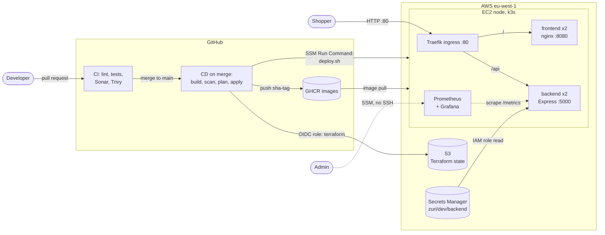

# Zuri Market: DevOps Capstone

Zuri Market is a small online store: a React storefront and an Express API serving an in-repo product catalogue. This repository is the platform around it: containers, infrastructure as code, a CI/CD pipeline with quality and security gates, Kubernetes on AWS, secrets management and monitoring.

| Part | Technology |
|---|---|
| Apps | React 18 + Vite 7 ([frontend](frontend/README.md)), Node.js 22 + Express ([backend](backend/README.md)) |
| Containers | Docker, Docker Compose, images in GitHub Container Registry (GHCR) |
| Infrastructure | Terraform modules on AWS (`eu-west-1`), remote state in S3 |
| Runtime | k3s (single-node Kubernetes) on EC2, Traefik ingress |
| CI/CD | GitHub Actions, SonarQube Cloud, Trivy, AWS access through OIDC |
| Secrets | AWS Secrets Manager, synced into a Kubernetes Secret at deploy time |
| Monitoring | Prometheus and Grafana (kube-prometheus-stack) |

## Architecture



Only port 80 is open to the internet. There is no SSH and no key pair: the node is reached through SSM Session Manager. `/metrics`, Prometheus and Grafana are not exposed publicly.

## Repository layout

```
.github/workflows/   ci.yml (pull requests), cd.yml (merge to main)
backend/             Express API, tests, Dockerfile
frontend/            React app, tests, Dockerfile, nginx.conf
k8s/                 namespace, RBAC, ingress, backend/ and frontend/ manifests
monitoring/          Helm values, ServiceMonitor, Grafana dashboard JSON
scripts/             deploy, secret sync, image tag, monitoring install, traffic generator
terraform/
  bootstrap/         S3 state bucket (run once, local state)
  github-oidc/       GitHub Actions to AWS trust and deployer role (run once, local state)
  modules/           network, security, secrets, compute
  environments/      dev and prod, same modules with different variables
docker-compose.yml   run both apps locally
```

## Run it locally

**With Docker Compose** (closest to production):

```bash
docker compose up --build -d
```

Open http://localhost:3000. nginx serves the storefront and proxies `/api` to the backend (also on http://localhost:5001). Stop with `docker compose down`.

**With npm** (for app development): see [backend/README.md](backend/README.md) and [frontend/README.md](frontend/README.md).

## CI/CD

| Workflow | Trigger | What it does |
|---|---|---|
| `ci.yml` | Pull request to `main` | Terraform fmt and validate; Kubernetes manifest and shellcheck checks; for each app: lint, tests with coverage, SonarQube Cloud quality gate, image build, Trivy scan (fails on HIGH or CRITICAL) |
| `cd.yml` | Merge to `main` (app, infrastructure, k8s or script changes) | Builds and re-scans both images, pushes them to GHCR as `sha-<commit>`; runs `terraform plan`; after approval in the `dev` environment, applies that exact plan and deploys to k3s through SSM Run Command, with automatic rollback and a smoke test |

Settings the workflows rely on:

- Secret `SONAR_TOKEN`
- Variables `AWS_REGION` and `AWS_ROLE_ARN` (no AWS access keys are stored in GitHub)
- Environment `dev` with a required reviewer
- `main` protected: pull request required, CI checks must pass

Third-party actions (SonarQube, Trivy) are pinned to full commit SHAs. Dependabot keeps actions, npm packages and base images up to date.

## Infrastructure

One-time setup, from your laptop with AWS credentials:

```bash
cd terraform/bootstrap
terraform init
terraform apply -var="region=eu-west-1" -var="bucket_name=zuri-market-tfstate-<ACCOUNT_ID>"

cd ../github-oidc
terraform init
terraform apply -var="region=eu-west-1"
```

After that, the dev environment is managed by the CD pipeline. To plan by hand:

```bash
cd terraform/environments/dev
terraform init
terraform plan -var-file=dev.tfvars
```

What dev creates: a VPC with one public and one private subnet (no NAT gateway); a security group allowing only port 80; an EC2 node (Amazon Linux 2023, IMDSv2 required, encrypted gp3 disk) that installs k3s on first boot; an IAM role limited to SSM and its own secret; and the empty secret `zuri/dev/backend`. `prod` uses the same modules with its own variables and state.

## Secrets

Secret values never go into Git, Terraform state or manifests. They are set once with the AWS CLI:

```bash
aws secretsmanager put-secret-value --secret-id zuri/dev/backend --secret-string file://secret.json
```

At deploy time, `scripts/sync-secrets.sh` runs on the node, reads the secret with the node's IAM role and writes the Kubernetes Secret `backend-secrets`, which the backend receives as environment variables. k3s encrypts Secrets at rest.

## Operating the cluster

Open a shell on the node:

```bash
aws ssm start-session --target <instance-id>
sudo -i
kubectl -n zuri-market get pods,svc,ingress
```

Roll back a bad release:

```bash
kubectl -n zuri-market rollout undo deployment/backend
```

`maxUnavailable: 0` keeps the old pods serving until new ones pass their readiness checks, so a broken image never takes the site down.

## Monitoring

Prometheus scrapes the backend's `/metrics` every 15 seconds. The Grafana dashboard **Zuri Market - API overview** shows request rate, error rate, p95 latency, requests by route and status, pod restarts and ready pods. It is stored in `monitoring/dashboards/` and loaded automatically.

Grafana and Prometheus are reachable only through SSM port forwarding:

```bash
aws ssm start-session --target <instance-id> --document-name AWS-StartPortForwardingSessionToRemoteHost \
  --parameters '{"host":["<node-private-ip>"],"portNumber":["30300"],"localPortNumber":["3001"]}'
```

Then open http://localhost:3001 (Grafana). Use port `30900` for Prometheus. The Grafana admin password is in the `grafana-admin` secret in the `monitoring` namespace.

To put real traffic on the dashboard, including some 401 and 404 responses:

```bash
bash scripts/generate-traffic.sh <node-public-ip>
```

## Design decisions

- **Single public node, no NAT gateway or load balancer.** Keeps cost low for a capstone. With more time: a domain with HTTPS, an ALB, and the node in the private subnet behind a NAT gateway.
- **SSM instead of SSH.** No keys to manage or leak, and every session is logged.
- **OIDC instead of stored AWS keys.** GitHub receives short-lived credentials, and only for this repository's `main` branch and `dev` environment.
- **Plan, approve, apply.** The deploy applies exactly the plan that was reviewed; a stale plan is refused.
- **Immutable image tags.** Manifests use `sha-<commit>`, never `:latest`, so every running pod maps to a commit.
